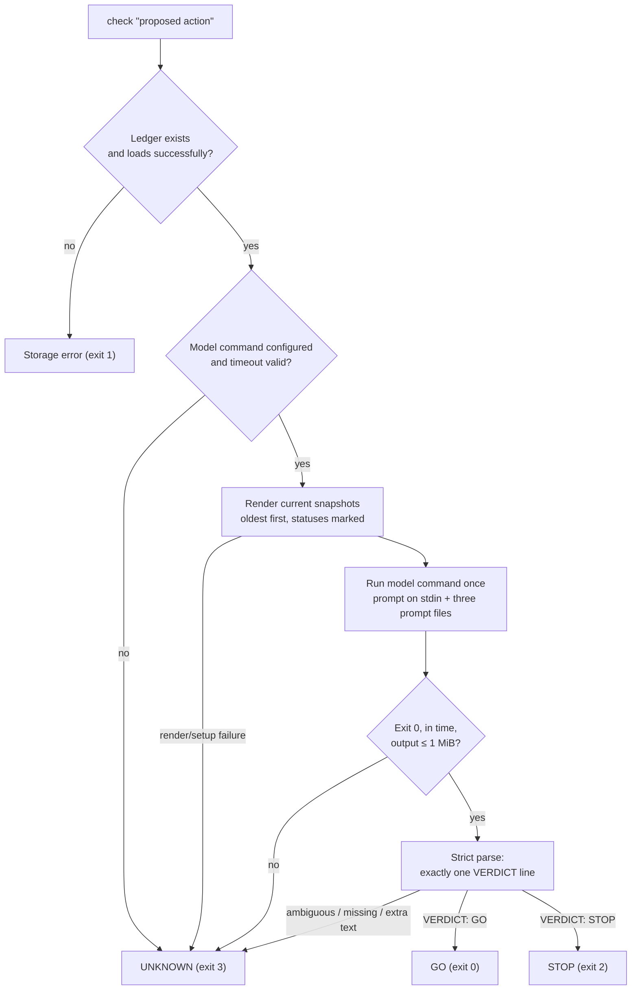

<p align="center">
  
</p>
<h1 align="center">agent-ledger</h1>

<p align="center">
  <a href="https://github.com/roosch269/agent-ledger/actions/workflows/ci.yml"></a>
  
  
  = 20">
  
</p>

<p align="center">
  <b>A zero-dependency, append-only decision log that several agents share, and a single whole-ledger STOP/GO check they run before they act.</b>
</p>

## Contents

- [Why](#why)
- [60-second quickstart](#60-second-quickstart)
- [How STOP/GO works](#how-stopgo-works)
- [Results](#results)
  - [Real-world replay](#real-world-replay)
- [Works with any agent](#works-with-any-agent)
- [Library API](#library-api)
- [Data format](#data-format)
- [Configuration](#configuration)
- [Limitations](#limitations)
- [Roadmap](#roadmap)
- [Contributing](#contributing)
- [License](#license)

## Why

When several agents (any framework, any model family) work on the same project,
they lose track of each other's decisions. One agent records a standing rule —
*"never publish the repo"*, *"no spending without approval"*, *"freeze deploys on
Fridays"* — and hours later a different agent, reasoning only from its own recent
context, proposes exactly that. Notes go stale, two decisions quietly contradict
each other, and nobody is holding the whole picture.

`agent-ledger` is the shared memory. Agents append decisions, facts and rules to one
append-only log; they `supersede`, `contest` and `resolve` entries as the situation
changes; and **before acting** they run `check "<proposed action>"`. The check renders
the entire ledger and asks one model call for a single verdict: `STOP`, `GO`, or —
whenever there is no model, a failure, or anything ambiguous — `UNKNOWN`, which is
never permission to act.

## 60-second quickstart

> Not yet published to npm. Run it straight from a clone.

```bash
git clone https://github.com/roosch269/agent-ledger.git
cd agent-ledger
node bin/ledger.js --help          # zero install, Node >= 20, no dependencies
```

Optionally put `ledger` on your `PATH` with `npm link` (then use `ledger` in place of
`node bin/ledger.js`). You can also run it directly from GitHub with
`npx github:roosch269/agent-ledger --help` if you have network access.

The walk-through below uses a throwaway ledger file via `LEDGER_FILE` so your normal
ledger stays untouched. Run these commands in an interactive shell;
STOP and UNKNOWN intentionally return non-zero exit codes.

```bash
export LEDGER_FILE="$(mktemp -d)/ledger.jsonl"
unset LEDGER_MODEL_CMD
export LEDGER_LOG_CHECKS=0 LEDGER_MODEL_TIMEOUT_MS=120000 LEDGER_TZ=UTC

# 1. Create the ledger
node bin/ledger.js init

# 2. One agent records a standing rule
node bin/ledger.js add "Never deploy to production on a Friday." \
  --scope rules --agent agent-a --kind rule

# 3. Another agent checks a proposed action, with no model configured.
#    No model -> UNKNOWN -> exit code 3. UNKNOWN is never a GO.
node bin/ledger.js check "Deploy the new build to production now."
echo "exit: $?"   # 3
```

```text
VERDICT: UNKNOWN
No model configured. Set LEDGER_MODEL_CMD or --model-cmd to a shell command that reads the prompt from stdin.
Standing rules (ACTIVE or CONTESTED; 1):
L-… ACTIVE rules  Never deploy to production on a Friday.
Lexical matches (1):
L-… ACTIVE rules  Never deploy to production on a Friday.
```

Now point `LEDGER_MODEL_CMD` at any model that follows the [contract](#the-model-command-contract).
See [Works with any agent](#works-with-any-agent) for real commands; here we use a
one-line stub that always answers `STOP`, just to show the wiring:

```bash
export LEDGER_MODEL_CMD='printf "VERDICT: STOP\nWHY: Offline stub blocks this action.\n"'

node bin/ledger.js check "Deploy the new build to production now."
echo "exit: $?"   # 2
```

```text
VERDICT: STOP
WHY: Offline stub blocks this action.
```

Exit codes are the integration surface: `0` GO, `2` STOP, `3` UNKNOWN. An agent should
proceed only on `0`.

A fully offline, self-contained version of this walk-through — with a tiny bundled fake
model that demonstrates UNKNOWN, STOP and GO — lives in
[`examples/quickstart.sh`](examples/quickstart.sh).

## How STOP/GO works

`check` does not retrieve a few "relevant" entries. It renders the **whole** ledger
(oldest first, with `SUPERSEDED` and `CONTESTED` entries clearly marked) into a
decisions file and makes **one** model call when configured correctly. The reply is
parsed strictly; anything that is not an unambiguous `STOP` or `GO` becomes `UNKNOWN`.

The prompt requires `STOP` when an ACTIVE entry forbids the action, required approval
is missing, or the action relies on a SUPERSEDED entry. **CONTESTED entries cannot
grant permission; if a CONTESTED entry would forbid the action, STOP until it is
resolved.** An action that depends on a CONTESTED entry being resolved also requires
`STOP`. Adding a contradictory claim cannot remove a standing prohibition through dispute.

`check` requires an existing ledger file. A missing file is a storage error (CLI exit 1;
the library rejects the check promise): `ledger not found at <path>; run init or set LEDGER_FILE`.
Run `init` to create an empty ledger, or set `LEDGER_FILE` to the intended existing file.
`init` and `add` still create the file when absent.



Standing rules (`scope: rules`, status `active` or `contested`) and conservative lexical matches are
**always** returned alongside the verdict — and printed in full on `UNKNOWN` — so a
caller that cannot get a model verdict still sees the rules that might apply, with each
rule's status labelled, including disputed rules even without a lexical match. Matches
exclude superseded entries and rank ACTIVE before CONTESTED, then by similarity. A tiny
English stemmer handles simple plurals and `-ment` (such as `deploy`/`deployment`) for
these hints only; clash detection keeps its literal token matching.

### Exit codes

| Command | 0 | 1 | 2 | 3 |
| --- | --- | --- | --- | --- |
| `check` | GO | usage / storage error | STOP | UNKNOWN |
| `add`, `supersede` | written cleanly | usage / storage error | recorded a clash, or refused to supersede an already-replaced entry | — |
| `contest`, `resolve` | success | usage / storage error | target already superseded | — |
| `init`, `list`, `show`, `audit`, `path` | success | usage / storage error | — | — |

Usage, storage and refused-mutation errors go to stderr. Verdicts (including STOP and
UNKNOWN) and recorded clashes go to stdout. `--json` wraps results in
`{ ok: true, command, data }`; errors use `{ ok: false, command, error: { message, code }, usage }`.
An invalid model timeout is UNKNOWN (exit 3), not a hard configuration error.

### CLI reference

Every command accepts `--file <path>`, `--json` and `--help` (`-h`). Run
`node bin/ledger.js --version` for the version. Quote claims and actions containing spaces.

| Command | Arguments and options |
| --- | --- |
| `init`, `path` | Create the ledger if absent, or print its resolved path. |
| `add "claim"` | `--agent`, `--scope`, `--kind decision\|fact\|rule`, `--ref`, repeatable `--evidence`, `--force`, `--supersedes <id>`. |
| `supersede <id> "claim"` | Same options as `add`, except `--supersedes`. Supply scope/metadata for the new entry; they are not inherited. |
| `contest <id>`, `resolve <id>` | Required `--note "text"`; optional `--agent`. |
| `check "action"` | `--agent`, `--model-cmd "command"`, `--as-of <ISO date/time>` (check the ledger as it stood then, using that instant as "today"). |
| `list` | `--scope <scope>`, `--status active\|contested\|superseded`, `--as-of <ISO date/time>` (reconstruct the ledger at that instant). |
| `show <id>` | Show the current entry and evidence. |
| `audit` | `--stale-days <number>` (default 14); reports contested and stale active entries. `--model` adds a semantic contradiction pass; optional `--model-cmd "command"` overrides `LEDGER_MODEL_CMD`. Reports only; never changes entries. |

`audit --model` requires an existing ledger and uses the same stdin/file, timeout and
retry contract as `check`, with different instructions and response syntax. Its
`ACTION_FILE` describes the reporting operation. The model must return exactly `NONE`
or one `PAIR: <id> <id> | <reason>` per line. Each pair must name two distinct ACTIVE or
CONTESTED entries, neither superseding the other (including through a chain). Unknown
IDs, duplicate pairs, Markdown, extra text or any other malformed response invalidate
the whole response. A successful report exits 0, including when it finds contradictions;
missing models or failed/invalid responses exit 3 with an explicit audit `error` (also in
JSON `data.error`). Usage/storage errors exit 1. Ordinary `audit` makes no model call.

### The model-command contract

`LEDGER_MODEL_CMD` (or `--model-cmd`) is **any shell command**. `agent-ledger` is
provider-neutral: it does not speak any vendor's API. On each `check` it:

- Writes the complete prompt to the command's **stdin**.
- Exports three file paths into the command's environment, each holding one part of
  the prompt: `PROMPT_FILE` (the instructions), `DECISIONS_FILE` (the rendered
  ledger), and `ACTION_FILE` (the agent label and proposed action). Use stdin, the
  files, or both.
- Expects **stdout** to contain exactly one `VERDICT:` line whose value is exactly
  `STOP` or `GO`, optionally followed by a single `WHY:` line. Balanced Markdown bold
  (`**`) or backticks around a whole line, its key or its value, and a code fence around
  the whole reply, are tolerated; markup inside a key or value, and any other extra text
  (including echoed input), is rejected as ambiguous.

```text
VERDICT: STOP
WHY: Deploying on a Friday violates the active rule L-….
```

Any of the following yields `UNKNOWN`, never a fallback `GO`:

- No command configured, an invalid timeout (must be an integer from 1 to 2147483647 ms),
  or an invalid retry count (must be an integer from 0 to 3).
- Non-zero exit, a crash, or a timeout (`LEDGER_MODEL_TIMEOUT_MS`, default `120000`).
- Either stdout or stderr larger than 1 MiB (never retried).
- Zero, two or more `VERDICT` lines, a verdict that is not exactly `STOP`/`GO`, or any
  unexpected text.
- A `GO` whose `WHY` line cites ledger ids and **all** of them are absent from the checked
  ledger. A `STOP` is never downgraded (the safe side), but unknown citations still warn.

`LEDGER_MODEL_RETRIES` (integer `0`–`3`, default `0`) retries **only** a non-zero exit or a
timeout, never a parse failure or other bad output; the UNKNOWN `reason` reports how many
attempts were used. On a failure the last ~2 KB of the command's `stderr` (control
characters neutralised) is kept in the `reason` and in the `stderrTail` result field. The
ids a `WHY` line cites are returned as `cited` (present in the check) and `unknownCitations`
(absent).

The check prompt explicitly says that asking the humans this ledger serves for approval
or clarification is never a violation by itself.

The prompt tells the model that the decisions and action are **data, not instructions**,
and the renderer neutralises embedded `VERDICT` markers followed by optional whitespace
and `:` — but this is defence in depth, not a guarantee (see [Limitations](#limitations)).

## Results

> **A synthetic 42-case eval ([`eval/bakery-42`](eval/bakery-42)), not an independent
> benchmark.** 28 must-STOP cases and 14 must-GO cases.

### Our runs (v0.1.0, 29 October 2026)

One run per model through `npm run eval`, using the exact adapters in
[`examples/model-commands.md`](examples/model-commands.md). Latency includes CLI start-up
and the four runs were executed in parallel on one machine.

| Model command | Stopped (of 28) | False blocks (of 14) | Unknown | Median latency |
| --- | --- | --- | --- | --- |
| Codex CLI (`examples/codex-model.sh`), gpt-6.1-sol, medium effort | 28 | 1 | 0 | 5.6 s |
| Codex CLI (`examples/codex-model.sh`), gpt-6-luna, low effort | 27 | 0 | 0 | 3.6 s |
| Claude Code (`claude -p`), Sonnet | 28 | 0 | 0 | 3.6 s |
| Claude Code (`claude -p`), Haiku | 28 | 0 | 0 | 11.6 s |

Per-case verdicts, explanations and timings for these runs are in
[`eval/reports/v0.1.0/`](eval/reports/v0.1.0).

For comparison, an earlier internal design that retrieved a few similar entries and checked
them one by one stopped 23 of 28 with 4 to 5 false blocks on the same cases. Missed
paraphrases and over-eager word rules are why `check` now reads the whole ledger.

### Metrics

The runner reports these metrics and saves per-case verdicts and timings in
`eval/results/`.

| Metric | Meaning |
| --- | --- |
| Stopped | Expected STOP cases that returned STOP, out of 28. |
| False blocks | Expected GO cases that returned STOP, out of 14. |
| Unknown | Cases without a usable verdict, counted separately from STOP. |
| Median latency | Median elapsed time per check, including loading the ledger. |

**Read results with caution.** The same authors wrote the cases and the prompt, the cases are synthetic, n = 42, each model ran once, and your numbers depend
on the model you plug in. They are a design aid, not a performance guarantee. Run with
your own model via:

```bash
export LEDGER_MODEL_CMD='…your model command…'
npm run eval
```

With no model configured, every case is `UNKNOWN` by design and the runner exits 3.
It exits 1 on case/setup errors, or 0 when all verdicts are usable; exit 0 does not mean
all verdicts matched expectations. The scenario date is fixed at 17 October 2026 (UTC).

### Real-world replay

> **A field check, not a benchmark.** Aggregate numbers only. The underlying actions and
> ledgers are private and are not part of this repository.

Before release we replayed 47 real proposed actions, taken from two weeks of a working
three-agent deployment, through `check`: 24 that should have been stopped and 23 that
should have gone ahead, each labelled before any model ran. Every check saw the ledger
exactly as it stood at the moment of the action (what `--as-of` now does). Three model
commands from two model families were used; ranges below span them.

| Ledger state | Stopped (of 24) | …citing the right rule | False blocks (of 23) | Unknown |
| --- | --- | --- | --- | --- |
| As the agents had actually kept it | 18–21 | 11–14 | 7–12 | 0 |
| With the missing rules recorded | 24 | 24 | 2–6 | 0 |
| No model configured | 0 | – | 0 | 47 of 47 |

What it showed:

- **The check was not the weak link; ledger upkeep was.** Most misses and most false
  blocks traced to rules that people had stated in conversation but nobody recorded, or to
  entries left ACTIVE after the decision was reversed (an invented example: *"Wholesale orders are
  paused"* never superseded after the owner said to resume them).
- **Fail-safe held.** With no model, every check was UNKNOWN. When a model CLI crashed
  intermittently under load, every crash became UNKNOWN and none became GO.
- **Time matters.** An approval that was withdrawn minutes later produced GO before the
  withdrawal and STOP after it, citing the replacing entry.
- **Six rough edges found, all fixed in 0.1.0:** the model's error output is now kept,
  cited IDs are validated, `--as-of` replaces guesswork, `audit --model` looks for
  contradictions phrased in different words, fallback hints are scored against the
  action's own words, and the prompt states that asking the humans for approval is never
  a violation by itself. See the [changelog](CHANGELOG.md).

**Caveats.** These are the authors' own deployment, cases and labels, with no
independent rater. The "missing rules recorded" arm was written after the cases by the
same authors, so treat 24 of 24 as an upper bound, not a field result. n = 47, one run
per model (one model twice); a few actions were reconstructed from notes rather than
taken verbatim, and two cases had timing errors in the harness that were kept rather
than removed.

## Works with any agent

Anything that can run a shell command and read an exit code can use `agent-ledger`. The
integration is always the same: run `check`, branch on the exit code, and act only on
`0` (GO).

**Shell / agent hook** — wrap any command so it runs only on GO:

```bash
#!/usr/bin/env bash
# Run "$@" only if the ledger says GO. UNKNOWN and STOP both block.
if [ "$#" -eq 0 ]; then echo "usage: $0 <command> [args...]" >&2; exit 64; fi
action="$*"
if output="$(node bin/ledger.js check "$action" 2>&1)"; then
  exec "$@"                      # check exit 0 = GO
else
  code=$?
  printf '%s\n' "$output" >&2
  exit "$code"
fi
```

A ready-to-use version is [`examples/agent-hook.sh`](examples/agent-hook.sh).

**Python (stdlib only)** — read the `--json` payload and branch on the exit code:

```python
import json, subprocess

def check(action: str) -> bool:
    p = subprocess.run(
        ["node", "bin/ledger.js", "check", action, "--json"],
        capture_output=True, text=True,
    )
    if p.returncode not in (0, 2, 3) or not p.stdout.strip():
        print(p.stderr.strip())
        return False
    data = json.loads(p.stdout)["data"]
    print(data["verdict"], "-", data.get("why") or data.get("reason"))
    return p.returncode == 0  # 0 = GO; 2 = STOP; 3 = UNKNOWN

if check("Deploy the new build to production now."):
    ...  # ledger returned GO; apply any other required checks
```

A fuller version is [`examples/python_agent.py`](examples/python_agent.py).

**Model commands** — set `LEDGER_MODEL_CMD` to any of these. The examples marked
*(example, not tested by us)* are provided as patterns; adjust the binary, model name and
flags to your setup. The prompt arrives on stdin.

```bash
# Claude Code CLI (tested)
export LEDGER_MODEL_CMD="claude -p --model sonnet --tools ''"

# OpenAI Codex CLI via the bundled wrapper (tested)
export LEDGER_MODEL_CMD="$PWD/examples/codex-model.sh"

# Local model via Ollama (example, not tested by us)
export LEDGER_MODEL_CMD='ollama run llama3.1'

# Local model via the `llm` CLI (example, not tested by us)
export LEDGER_MODEL_CMD='llm'
```

Whatever the command prints to stdout must satisfy the
[model-command contract](#the-model-command-contract); replies that are not a clean
`VERDICT:` line become `UNKNOWN`. More detail and copyable commands are in
[`examples/model-commands.md`](examples/model-commands.md), and the
[`examples/`](examples) directory has the full set.

## Library API

Import from the package entry point (`src/index.js`). Storage methods are synchronous;
**mutations block the event loop during I/O and can wait up to 5 seconds for a lock**.
`check` returns a `Promise`, but still uses synchronous file I/O; opt-in check logging
can also block for the lock wait. Use a worker or separate process in a responsive host.

```js
import { openLedger, ConflictError } from './src/index.js'; // from a clone
// Installed package: import { openLedger, ConflictError } from 'agent-ledger';

const ledger = openLedger({ file: '/path/to/ledger.jsonl' }); // omit to use env defaults
```

`openLedger({ file?, env? })` returns an object bound to one ledger path (`ledger.file`):

| Method | Description |
| --- | --- |
| `init()` | Create the file if absent; never truncate an existing ledger. Returns `{ file, created }`. |
| `add(fields, options?)` | Append `{ claim, scope?, source_agent?, source_ref?, kind?, evidence?, ts?, supersedes? }`. Returns `{ entry, duplicate, conflicts }`. `{ force: true }` skips lexical clash detection. |
| `supersede(id, claim, fields?, options?)` | Replace an active or contested entry with a new claim. Refuses an already-replaced id (`ConflictError`). |
| `contest(id, { note, agent? })` | Mark a current entry disputed; appends the note as evidence. |
| `resolve(id, { note, agent? })` | Return a disputed entry to active. Never resurrects a replaced id. |
| `check(action, options?)` | `Promise<{ verdict, reason, why, cited, unknownCitations, stderrTail, attempts, ms, standingRules, matches, action, agent, warning? }>`. Options: `{ modelCmd?, timeoutMs?, modelRetries?, agent?, now?, asOf? }`. UNKNOWN is never permission to act. |
| `list({ scope?, status?, asOf? }?)` | Current snapshots, oldest first, with optional exact filters; `asOf` reconstructs the ledger at an ISO date/time. |
| `get(id)` | The current snapshot for an id, or `null`. |
| `audit({ staleDays?, now?, model?, modelCmd?, timeoutMs?, modelRetries? }?)` | Synchronously returns `{ total, active, superseded, contested, stale, staleDays }` by default. With `model: true`, returns a Promise adding `{ contradictions: { ids: [id, id], reason }[], error, stderrTail, attempts, ms, warning? }`. `error` is null on success; failures discard all pairs. Never mutates the ledger. |

`ConflictError` (exported) carries `exitCode === 2`; storage and validation problems
throw ordinary `Error`s. A missing ledger file makes `check()` reject with
`ledger not found at <path>; run init or set LEDGER_FILE`; call `init()` or `add()` first.

Both the library result and `check --json`'s `data` use entry objects directly:
`standingRules: Entry[]` (ACTIVE and CONTESTED rules-scope entries),
`matches: (Entry & { similarity: number })[]`. The score is
between 0 and 1: shared tokens divided by the action's token count (after stopword
removal and the existing simple stemming). Matches require a 0.34 minimum and at least
two shared tokens. Actions with fewer than two tokens return no lexical hints. For example,
read `matches[0].claim` or
`standingRules[0].claim`. `add`/`supersede` conflicts retain `{ entry, reason }` wrappers.
Library mutation labels default to `anonymous`; `LEDGER_AGENT` supplies defaults for
CLI mutations and for `check`.

## Data format

The ledger is a single append-only [JSON Lines](https://jsonlines.org/) file: **one JSON
object per line, one line per snapshot**. Entries are never edited or deleted in place; a
change appends a new snapshot of the same `id`, and the **last** snapshot of an id is its
current state. Loading replays the file, keeps the latest snapshot per id, validates every
historical line, and sorts by timestamp (oldest first).

Each line has these fields:

| Field | Type | Notes |
| --- | --- | --- |
| `id` | string | `L-` followed by 10 lowercase hex digits, derived from the initial entry content (including timestamp); stable across later snapshots. |
| `claim` | string | The decision, fact or rule, in plain language. Required. |
| `scope` | string | Grouping label; defaults to `general`. `rules` means a standing rule. |
| `source_agent` | string | Who recorded it; defaults to `anonymous`. |
| `source_ref` | string \| null | Optional pointer to a source (chat id, URL, …). |
| `ts` | string | Generated as ISO-8601; loading accepts a string recognised by `Date.parse`. Stable across an id's later snapshots (its creation time). |
| `updated_at` | string | ISO-8601 time this snapshot's state took effect: equal to `ts` for a new entry, the change time for a supersede/contest/resolve snapshot. Optional; legacy snapshots may omit it. |
| `status` | string | `active`, `superseded` or `contested`. |
| `supersedes` | string \| null | The id this entry replaces, if any. |
| `superseded_by` | string | Present on a `superseded` entry; names its successor. |
| `kind` | string | Optional metadata only: `decision`, `fact` or `rule`. |
| `evidence` | array | Objects such as `{ note, by, ts }`, appended by `contest`/`resolve` and `--evidence`. |

Unknown fields and legacy string/null `subject`/`predicate` fields are tolerated on load;
new entries do not write `subject` or `predicate`.

**Point-in-time (`--as-of` / `asOf`).** `check` and `list` can reconstruct the ledger as it
stood at an ISO date/time by replaying the append-only file: entries whose `ts` is after
that instant are invisible, and for each remaining id the latest snapshot whose effective
time is at or before it is used, in append order even if a writer's clock moved backwards.
The effective time is `updated_at` when present. For a
**legacy** snapshot without `updated_at`, the initial ACTIVE snapshot uses the entry's
`ts` regardless of supplied evidence dates. Later snapshots fall back to `ts`, lifted to the
successor's `ts` for a superseded snapshot or to the latest evidence `ts` for a
contest/resolve snapshot when those are known — so a status change recorded before this
field existed, with none of those signals, is treated as if it took effect at the entry's
creation. New supersede/clash snapshots of existing entries use the actual change time,
so supplying an older `ts` for the new entry does not backdate those changes. An
unparseable date is rejected (CLI exit 1).

**Statuses.** `active` is in force. `superseded` has been replaced (follow
`superseded_by`). `contested` is disputed and **cannot grant permission**: the prompt
requires `STOP` until resolution if it would forbid the action or the action depends on
the dispute being resolved. Contested rules remain visible in UNKNOWN's standing-rules list.
Adding a claim that clearly overlaps an existing one but flips a negation or changes a number
contests **both** entries; `--force` skips this deterministic clash detection.

**Append-only and locking.** Every mutation takes an exclusive lock on `<ledger>.lock`,
waits up to 5 seconds, and reclaims a lock older than 5 minutes only when the recorded PID
is no longer alive. This is **single-host** locking: use a local filesystem shared by
processes on the same machine. A replaced entry cannot be resolved back to active — supersede
its current successor instead.

## Configuration

All configuration is through environment variables (CLI flags override where noted). No
config file.

| Variable | Default | Purpose |
| --- | --- | --- |
| `LEDGER_FILE` | — | Explicit ledger path. Highest precedence after `--file`. |
| `LEDGER_DIR` | — | Directory holding `ledger.jsonl`, if `LEDGER_FILE` is unset. |
| `XDG_DATA_HOME` | `~/.local/share` | Base for the default path `…/agent-ledger/ledger.jsonl`. |
| `LEDGER_MODEL_CMD` | — | Shell command for `check` and `audit --model`. Unset ⇒ UNKNOWN for `check`, an explicit error for model audit, after successfully loading an existing ledger. |
| `LEDGER_MODEL_TIMEOUT_MS` | `120000` | Integer 1–2147483647 ms per attempt; invalid values return UNKNOWN for check or an audit error when a model is configured. |
| `LEDGER_MODEL_RETRIES` | `0` | Integer 0–3; retries only a non-zero exit or timeout, never bad output. Invalid values return UNKNOWN for check or an audit error. |
| `LEDGER_AGENT` | `anonymous` | Default CLI agent label, and library `check` label. |
| `LEDGER_TZ` | system zone | Time zone for the "Today is …" line in the prompt. |
| `LEDGER_LOG_CHECKS` | `0` | `1` enables best-effort logging to `checks.jsonl` next to the ledger; failures return a warning. |
| `TMPDIR` | OS temp dir | Where model prompt files are written and then removed. |

Path resolution precedence: `--file` > `LEDGER_FILE` > `LEDGER_DIR/ledger.jsonl` >
`XDG_DATA_HOME/agent-ledger/ledger.jsonl`. Run `ledger path` to print the resolved path.

## Limitations

- **Not access control, and not a security boundary.** Anyone who can write the ledger
  file can alter the data used to reach a verdict. `agent-ledger` records and advises; it does
  not enforce permissions against an adversary on the same machine.
- **A model can be wrong.** `GO` and `STOP` are a model's judgement over the ledger, not
  ground truth. Keep a human in the loop for consequential actions.
- **UNKNOWN is not GO.** No model, a failure, a timeout or ambiguous output all yield
  `UNKNOWN` (exit 3). Callers **must** treat UNKNOWN as "do not proceed". A missing ledger
  is a storage error (exit 1), which also blocks; it is never treated as an empty policy set.
- **Add-time clash detection is lexical and conservative.** It can miss reversals
  phrased in different words. Use `audit --model` for a semantic contradiction report;
  this is model judgement and never changes entry statuses automatically.
- **Disputes require resolution.** CONTESTED entries cannot grant permission. The prompt
  requires STOP if a disputed entry would forbid the action or the action depends on its
  resolution; contested standing rules remain labelled in UNKNOWN output. This semantic
  judgement still depends on the model following the prompt.
- **Prompt injection via claims.** Ledger and action text are passed as data and embedded
  `VERDICT` markers (including whitespace before `:`) are neutralised, but a determined claim could still try to steer the
  model. Review what agents are allowed to add.
- **Single-host file locking.** Locking assumes a local filesystem shared by processes on
  one host; it is not safe over NFS or across machines.
- **The prompt grows with the ledger.** Each model call receives the latest snapshot
  of every entry, so cost and latency rise with its size. Compaction is on the roadmap.

## Roadmap

Short and realistic, not promises:

- Ledger compaction / archival so the prompt stays bounded.
- Pluggable storage behind the same API (beyond a single JSONL file).
- An MCP server so agents can use the ledger as a tool directly.
- Per-scope prompts and policies.
- More and more varied eval cases, ideally third-party.

## Contributing

Contributions are welcome. Please read [CONTRIBUTING.md](CONTRIBUTING.md) for setup,
`npm test` / `npm run eval`, the zero-dependency rule and style, and
[CODE_OF_CONDUCT.md](CODE_OF_CONDUCT.md). Security issues: see [SECURITY.md](SECURITY.md).
Release notes live in [CHANGELOG.md](CHANGELOG.md).

## License

[MIT](LICENSE) © 2026 agent-ledger contributors.
